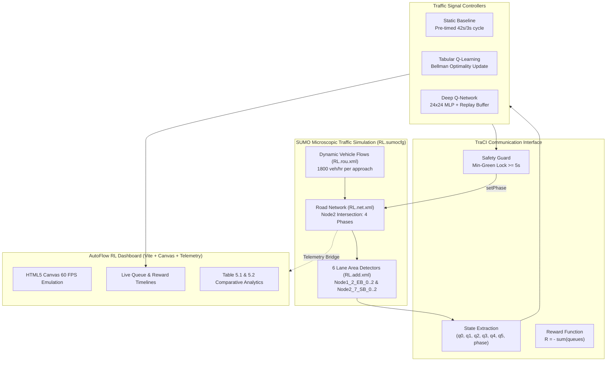

# System Architecture — AutoFlow RL

## 1. High-Level Overview

AutoFlow RL is an intelligent, simulation-based traffic signal optimization platform developed to replace rigid fixed-time controllers with adaptive reinforcement learning agents. The system is designed around microscopic traffic simulation in **Eclipse SUMO** (Simulation of Urban MObility) and controlled in real time using the **TraCI** (Traffic Control Interface) Python protocol, paired with an interactive modern web dashboard.

---

## 2. Reinforcement Learning Formulation

The control problem is formalized as a discrete-time Markov Decision Process (MDP):

### 2.1 State Space $S$
The intersection state vector $s_t \in \mathbb{R}^7$ is sampled at each discrete simulation step $t$:
$$s_t = \Big( q_{\text{EB}_0}, q_{\text{EB}_1}, q_{\text{EB}_2}, q_{\text{SB}_0}, q_{\text{SB}_1}, q_{\text{SB}_2}, \phi_t \Big)$$
where:
- $q_{\text{EB}_i}$ is the vehicle queue count measured by the $i$-th lane area detector on the Eastbound approach (`Node1_2_EB_0`, `Node1_2_EB_1`, `Node1_2_EB_2`).
- $q_{\text{SB}_j}$ is the vehicle queue count measured by the $j$-th lane area detector on the Southbound approach (`Node2_7_SB_0`, `Node2_7_SB_1`, `Node2_7_SB_2`).
- $\phi_t \in \{0, 1, 2, 3\}$ is the current traffic light phase index.

### 2.2 Action Space $A$
The agent evaluates binary control decisions $a_t \in \{0, 1\}$:
- $a = 0$ (**Keep Phase**): Retain current signal state.
- $a = 1$ (**Switch Phase**): Transition to the next signal phase.

### 2.3 Reward Function $R$
The reward penalizes congestion across all monitored approaches:
$$R_t = -\sum_{i=1}^{6} q_{i,t}$$
Maximizing cumulative return $\sum_{t} \gamma^t R_t$ directly minimizes intersection queue lengths and total delay.

### 2.4 Safety Guard (Minimum Green Time)
In real-world traffic engineering, rapid oscillation between signal phases creates severe rear-end collision hazards and gridlock. AutoFlow RL enforces an unbreakable **Minimum Green Constraint**:
$$\Delta t_{\text{phase}} \ge T_{\text{min\_green}} = 5.0\text{ seconds}$$
If $a_t = 1$ is chosen by an agent before 5 seconds have elapsed in the current green phase, the safety guard intercepts the decision and overrides it to $a_t = 0$.

---

## 3. Controller Architectures

### 3.1 Static Fixed-Time Baseline (`simulation/Static.py`)
- Employs deterministic timing plans matching standard municipal signal controllers.
- Phase 0 (Eastbound Green): 42s
- Phase 1 (Eastbound Yellow): 3s
- Phase 2 (Southbound Green): 42s
- Phase 3 (Southbound Yellow): 3s
- Total Cycle Length: 90s.
- Operates strictly open-loop without feedback from lane detectors.

### 3.2 Tabular Q-Learning Controller (`simulation/QL.py`)
- Maintains an explicit action-value table $Q(s, a)$.
- Learning rate $\alpha = 0.1$, discount factor $\gamma = 0.9$, exploration rate $\epsilon = 0.1$.
- Updated at each simulation step via the Bellman Optimality Equation:
  $$Q(s_t, a_t) \leftarrow Q(s_t, a_t) + \alpha \Big[ R_{t+1} + \gamma \max_{a'} Q(s_{t+1}, a') - Q(s_t, a_t) \Big]$$
- Compact and lightweight; fast convergence for dominant state configurations.

### 3.3 Deep Q-Network Controller (`simulation/DQN.py`)
- Neural network function approximator $Q(s, a; \theta)$:
  - **Input Layer**: 7 features (continuous normalized queue counts and discrete phase).
  - **Hidden Layer 1**: 24 neurons, ReLU activation function.
  - **Hidden Layer 2**: 24 neurons, ReLU activation function.
  - **Output Layer**: 2 neurons (linear outputs representing $Q(s, 0)$ and $Q(s, 1)$).
- **Experience Replay Buffer**: Circular buffer with capacity $N = 2000$. Minibatch updates of size $B = 32$ break temporal correlation between consecutive states.
- **Loss Function**: Mean Squared Error (MSE):
  $$L(\theta) = \mathbb{E} \left[ \left( R + \gamma \max_{a'} Q(s', a'; \theta^-) - Q(s, a; \theta) \right)^2 \right]$$
- **Portability**: Native TensorFlow/Keras support with automatic pure-NumPy vectorization fallback when running in lightweight environments.

---

## 4. Web Dashboard Architecture (`AutoFlow RL`)

The frontend is built using **Vite**, **ES Modules**, **HTML5 Canvas**, and **CSS3 Variables**:
- **Canvas Renderer (`src/sim/renderer.js`)**: 60 FPS sub-pixel rendering of the intersection, 6 detector zones, dynamic vehicles with car-following physics, and traffic signal gantries.
- **Simulation Engine (`src/sim/trafficEngine.js`)**: Accurate client-side emulation of the SUMO environment allowing instant zero-setup demonstration in any web browser.
- **Live Telemetry (`src/sim/charts.js`)**: Real-time dual-canvas timeline graphs for queue length tracking and reward progression.
- **TraCI Telemetry Bridge (`simulation/traci_bridge.py`)**: Local HTTP server exposing `/api/status` and `/api/step` to bridge actual running SUMO TraCI instances directly into the web dashboard.
